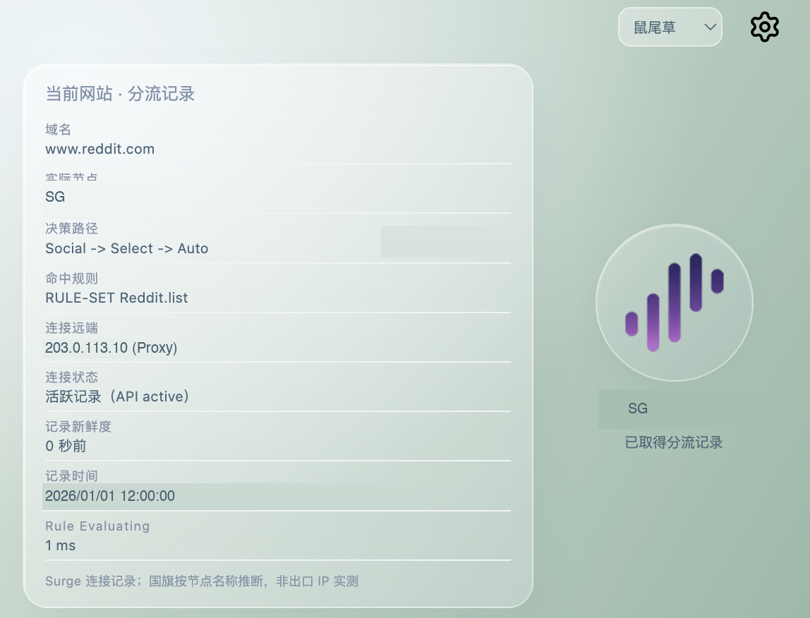

# RouteLens · 线路透镜

当前网站走哪个节点，一眼看清。

面向 **Surge for Mac** 的 Chrome Manifest V3 扩展，通过本机 HTTP API 读取当前域名的连接记录。仅支持 Surge，不需要额外 helper。

## 功能

- 打开面板、切换标签或网页加载完成时查询线路。
- 展示实际节点、决策路径、命中规则、连接远端和记录时间。
- 工具栏圆形国旗搭配大写地区代码。
- 根据节点中的地区代码、中文／英文地区名、国旗 emoji 依次识别地区。
- 展示 API 提供的连接状态、记录新鲜度及非 DNS 计时；缺失字段不展示。
- 四款主题、透明 Logo、悬停浮起和渐变涟漪。

## 使用截图

### 工具栏国旗与地区角标

工具栏同时展示国旗图标与大写地区代码，下图为 SG 显示示例。

### 分流信息面板

基于实际使用截图脱敏：节点仅保留地区代码 SG，时间与连接远端分别替换为示例时间和文档保留地址。其余界面内容保留；这些替换值仅作展示，不代表真实测量。原始截图及修改批注未上传。

## 安装

1. 下载 Release 中的 ZIP 并解压。
2. 打开 `chrome://extensions/`，开启开发者模式。
3. 点击「加载已解压的扩展程序」，选择包含 `manifest.json` 的目录。
4. 固定扩展，打开设置填写 Surge API 地址和密钥。

需先在 Surge 启用本机 HTTP API，认证方式为 `X-Key`。地址示例：`http://127.0.0.1:6171`。以个人实际配置为准，扩展不会替你修改 Surge 配置。

API 参考：https://manual.nssurge.com/others/http-api.html

## 数据与限制

- 线路来自 Surge 活跃／近期记录，可能是历史观察，不保证策略切换后的实时路由。请查看记录时间。
- 同一网站可能存在多条连接；面板优先选择正常分流记录而非拦截记录，不代表所有子资源。
- 地区按节点名推断，不是出口 IP 地理实测。命名错误可能导致识别错误。
- `DIRECT` 按显示约定使用中国国旗和 `DIR`；`TW` 使用中国国旗与 `TW` 代码。这不是位置测量。
- 连接远端不等同于经过独立验证的公网出口 IP。
- 不使用第三方 IP 检测服务冒充当前网站分流。
- 不提供独立节点 Ping、DNS 测速或上传／下载面板。
- Loon、Quantumult X 等其他客户端不受支持。

## 隐私

API 地址、密钥和主题保存在本机扩展存储；无遥测。请保护 API 密钥，不要把个人配置上传到仓库。运行时连接查询仅访问本机 API。

## 素材与授权

- 品牌、网络及部分国家图标：[lige47 图标集](https://github.com/lige47/QuanX-icon-rule)。部分国旗经圆形遮罩处理。
- 其他国家图标来自 [FlagCDN](https://flagcdn.com/)。
- 设置齿轮：[Lucide](https://github.com/lucide-icons/lucide)（ISC License）。

品牌及商标归原权利方所有。第三方图标不因本项目发布而获得新的授权；使用、转载请遵循各素材原作者条款。本项目不声称图标为官方素材。

本项目与 Surge 官方无隶属关系。

## 验证情况

已进行 JavaScript 语法、域名匹配及地区识别测试；Surge 分流记录功能经实际使用。各客户端版本、所有计时字段和浏览器环境未完成完整兼容矩阵验证。
